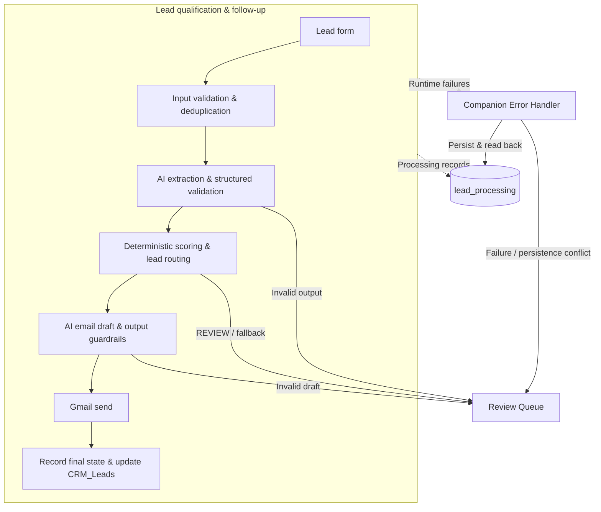

# AI Lead Qualification & Follow-up

**From incoming inquiry to qualified lead, guarded email response, and an auditable CRM record.**

A two-workflow system that uses Gemini to interpret inquiries and draft replies, deterministic rules to qualify leads, and a dedicated Error Handler to manage failures around email delivery.

**n8n · Gemini · Gmail · Google Sheets · Data Tables**

[Main workflow](./AI-Lead-Qualification-Followup.json) · [Error Handler](./AI-Lead-Qualification-Error-Handler.json) · [Setup](#setup)

## Architecture



Solid arrows show processing and review paths; dashed arrows show supporting state and runtime handling. Invalid form submissions are logged before AI processing; matching duplicates stop at the duplicate check.

## Engineering highlights

| Design choice | What it demonstrates |
|---|---|
| **AI extraction with a contract** | Seven structured fields are checked for types, allowed values, exact keys, and consistency with the submitted choices. |
| **Business scores owned by code** | Service-specific budget fit, intent, timeline, and clarity produce a fixed 0–10 score; AI confidence triggers review rather than adding points. |
| **Duplicate handling that permits corrections** | Normalized email + message identifies duplicates; invalid submissions use a prefixed audit key so a corrected inquiry can proceed. |
| **Controlled customer communication** | Status-specific drafts pass recipient, shape, length, HTML, link, and internal-phrase checks before Gmail. |
| **Failures checked after persistence** | The companion workflow classifies the failure, writes the operational state, reads it back, and routes mismatches to a persistence-conflict review entry. |

**Routing has explicit precedence:** confidence below `0.60` or category `Other` → `REVIEW`; missing details or unclear intent → `NEEDS_INFO`; otherwise, scores ≥8 → `HOT`, ≥5 → `WARM`, and lower scores → `COLD`.

`HOT`, `WARM`, `COLD`, and `NEEDS_INFO` receive tailored email drafts. `REVIEW` and unmatched routing go to human review without sending an email.

## Reliability & safety

| Risk | Handling |
|---|---|
| Bad form input | Logged as `INVALID_INPUT` before AI or Gmail runs. |
| Duplicate lead | A matching normal dedupe key stops reprocessing. |
| Malformed AI output | Null/type-safe validation sends rejected output to `AI_OUTPUT_INVALID` review. |
| Invalid email draft | Guardrails block Gmail and send the draft failure to `EMAIL_DRAFT_INVALID` review. |
| Lead requiring judgment | Low-confidence or uncategorized leads enter the Review Queue. |
| Ambiguous Gmail result | Classified as `SEND_UNCERTAIN`; the Error Handler has no resend path. |
| State write mismatch | Read-back checks route the conflict for human investigation. |

Customer content is treated as untrusted data in both AI prompts. Model or parser exceptions that occur before validation are handled as runtime failures, rather than being confused with a controlled validation rejection.

## Data & state architecture

| Layer | Responsibility |
|---|---|
| **CRM_Leads** | Human-facing inquiry and qualification details, appended or updated by `Lead ID` after the successful email/final-state path. |
| **Review Queue** | Actionable exceptions with reason, lead/execution reference, email status, and resolution fields. |
| **lead_processing** | Technical audit state: dedupe key, execution ID, processing/email status, score, Gmail message ID, and errors. |

This keeps business records separate from processing state and work requiring human intervention.

## Companion Error Handler

An email-send failure and a CRM-write failure require different responses. The handler uses the failed node name to classify where execution stopped:

| Stage | Handling for a matched lead |
|---|---|
| `BEFORE_GMAIL` | Records the pre-send failure and verifies the resulting state. |
| `AT_GMAIL` | Uses structured HTTP/provider evidence to distinguish `SEND_FAILED` from `SEND_UNCERTAIN`. |
| `AFTER_GMAIL` | Records the downstream failure with `EMAIL_SENT`, without sending again. |
| `UNKNOWN` | Records the failure while preserving the existing email status and Gmail message ID. |

**Uncertainty is preserved:** without recognized rejection evidence, a Gmail failure defaults to `SEND_UNCERTAIN`. It is escalated for investigation, not automatically retried. Missing execution IDs or unmatched lead records also have dedicated review paths.

## Validation

The project author reported the following **live n8n regression tests passed** before publishing these templates. This is functional validation, not a throughput benchmark or reliability guarantee.

| Regression | Validated behavior |
|---|---|
| Corrected `INVALID_INPUT` submission | Same email + message can proceed after correcting the invalid field. |
| Normal duplicate | Matching non-INVALID_INPUT lead remains blocked. |
| Missing/null/malformed AI output | Rejected through the controlled failure path without validation-expression errors. |
| Malformed email draft | Rejected before Gmail through the existing review path. |
| End-to-end email + CRM | HOT / score 8 fixture completed with one Gmail send, stored message ID, `COMPLETED` / `EMAIL_SENT`, a CRM row, and no Error Handler invocation. |

## Skills demonstrated

**LLM structured outputs & guardrails** · **n8n workflow engineering** · **Deterministic business logic** · **State management & audit trails** · **Failure classification & persistence verification** · **Google APIs / OAuth & CRM integration** · **Regression testing**

## Project files

| Workflow | Role |
|---|---|
| [AI-Lead-Qualification-Followup.json](./AI-Lead-Qualification-Followup.json) | Main workflow: intake, qualification, email guardrails, Gmail, and CRM updates — 25 nodes. |
| [AI-Lead-Qualification-Error-Handler.json](./AI-Lead-Qualification-Error-Handler.json) | Companion workflow: runtime classification, failure-state persistence, read-back verification, and review queues — 32 nodes. |

## Setup

1. **Prepare n8n and resources.** Use an instance supporting the exported node versions, including Data Table 1.1. Create `lead_processing` and a Google spreadsheet with `CRM_Leads` and `Review Queue` tabs using the schema below.
2. **Import both JSON files** as separate workflows in the same project. Keep the main workflow inactive during configuration.
3. **Connect your credentials.** Assign Gemini to both chat-model nodes, Gmail OAuth to `Gmail Send`, and Google Sheets OAuth to every Sheets node in both workflows. Confirm access to the configured Gemini models.
4. **Replace the resource placeholders** in both workflows. Both must share the same backend table and Review Queue; verify the column mappings after selecting resources.
5. **Link the handler manually.** In the main workflow's **Settings → Error Workflow**, select **AI Lead Qualification - Error Handler** and save. Import alone does not create this link.
6. **Validate before activation.** Use a separate test copy and resources you control, check the regression cases above, and verify state, review, and CRM writes before enabling the live form.

Keep node names unchanged: expressions and failure classification depend on exact names. Human review does not automatically resolve or resend a failed inquiry.

<details>
<summary><strong>Resource placeholders</strong></summary>

| Placeholder | Your resource |
|---|---|
| `REPLACE_WITH_LEAD_PROCESSING_TABLE_ID` | `lead_processing` in all Data Table nodes |
| `REPLACE_WITH_GOOGLE_SPREADSHEET_ID` | CRM spreadsheet in all Google Sheets nodes |
| `REPLACE_WITH_CRM_LEADS_SHEET_ID` | `CRM_Leads` tab |
| `REPLACE_WITH_REVIEW_QUEUE_SHEET_ID` | `Review Queue` tab |

</details>

<details>
<summary><strong>Google Sheets headers</strong></summary>

Create these headers exactly, one per column. The CRM timestamp display uses `Asia/Karachi`.

**CRM_Leads**

```text
Submitted At
Full Name
Email
Company
Business Type
Service Needed
Service Category
Budget Range
Timeline
Requirements Summary
Lead Score
Lead Status
Original Message
Intent
Lead ID
```

**Review Queue**

```text
review_id
created_at
lead_id
execution_id
email
review_reason
failed_node
error_message
email_status
review_status
review_notes
resolved_at
```

</details>

<details>
<summary><strong>lead_processing schema & existing-data migration</strong></summary>

Create these user-defined columns; n8n's built-in row fields are separate.

| Column | Type |
|---|---|
| `lead_id` | String |
| `dedupe_key` | String |
| `email` | String |
| `processing_status` | String |
| `lead_status` | String |
| `lead_score` | Number |
| `email_status` | String |
| `gmail_message_id` | String |
| `error_code` | String |
| `error_message` | String |
| `model_name` | String |
| `prompt_version` | String |
| `workflow_version` | String |
| `created_at` | Date/time |
| `processed_at` | Date/time |
| `execution_id` | String |

For an existing installation, back up the table before migrating old invalid submissions. Prefix an unprefixed `dedupe_key` with `INVALID_INPUT|` only when `processing_status` is exactly `INVALID_INPUT`. Preserve the original key after that prefix; do not double-prefix rows or alter other statuses. A fresh table needs no migration.

</details>

## Template notes

Both exports use public placeholders and include no credentials. Validate your resource bindings, model access, and Error Workflow link before production use. Duplicate protection is a lookup followed by an insert, not an atomic lock; **exactly-once delivery is not guaranteed**. Prompt restrictions and output checks do not guarantee every generated response is accurate or safe.

[Back to project index](../README.md) · MIT License
