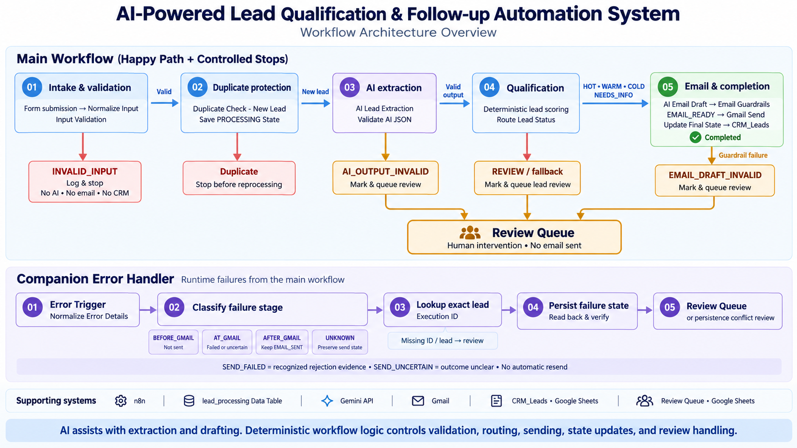

# AI Lead Qualification & Follow-up

**Turn incoming inquiries into qualified leads, tailored email replies, and traceable CRM records.**

This system handles lead intake, qualification, and follow-up in one flow, with a separate queue for cases that need human judgment. Gemini extracts information and drafts replies; fixed workflow rules control scoring, validation, sending, and review.

**n8n · Gemini · Gmail · Google Sheets · Data Tables**

[Main workflow](./AI-Lead-Qualification-Followup.json) · [Error Handler](./AI-Lead-Qualification-Error-Handler.json) · [Validation](#validation) · [Setup](#setup)

## Architecture



**The main flow:** validate the inquiry → check for duplicates → extract and qualify the lead → check the email draft → send through Gmail → record the outcome in the CRM. Exceptions follow controlled review paths.


<br><br>


## Engineering highlights

| Design choice | Why it matters |
|---|---|
| **Checked AI output** | Extracted information must match a defined structure and the submitted choices before it is used. |
| **Rule-based scoring** | Code calculates a fixed 0–10 score from budget fit, intent, timeline, and clarity; the AI does not assign the business score. |
| **Duplicates without blocking corrections** | Matching email + message stops repeat processing, while a corrected invalid submission can proceed. |
| **Email checks before sending** | Drafts must pass recipient, format, length, HTML, link, and internal-phrase checks before reaching Gmail. |
| **Verified failure records** | After recording a failure, the Error Handler reads the state back to confirm it was saved; mismatches go to manual review. |

Leads route to **HOT, WARM, COLD, NEEDS_INFO, or REVIEW**. The first four receive tailored email drafts; REVIEW and unmatched routes go to human review without sending.

<br><br>


## Reliability & safety

**Rejected input or output is stopped before it can reach the next consequential step.**

| Risk | Controlled response |
|---|---|
| Invalid form input | Record `INVALID_INPUT`; stop before AI or Gmail. |
| Malformed AI output | Send rejected output to `AI_OUTPUT_INVALID` review. |
| Invalid email draft | Block Gmail and queue `EMAIL_DRAFT_INVALID` review. |
| Lead requiring judgment | Send low-confidence or uncategorized leads to the Review Queue. |

Customer content is treated as untrusted data in both AI prompts. Model or parser exceptions before validation go to the runtime Error Handler; they are distinct from controlled validation rejections.

## Data & state architecture

**Business records, human review, and processing history have separate homes.**

| Layer | Purpose |
|---|---|
| **CRM_Leads** | Inquiry and qualification details for people to use, written by `Lead ID` after the successful email/final-state path. |
| **Review Queue** | Cases needing intervention, with the reason, lead/execution reference, email status, and resolution fields. |
| **lead_processing** | Processing history: duplicate key, execution ID, statuses, score, Gmail message ID, and errors. |

## Companion Error Handler

**The system distinguishes failures before, during, and after Gmail sending so it does not blindly resend when delivery status is uncertain.** The failed node name determines the stage.

| Stage | Handling for a matched lead |
|---|---|
| `BEFORE_GMAIL` | Record the pre-send failure and verify the saved state. |
| `AT_GMAIL` | Use HTTP/provider evidence to distinguish `SEND_FAILED` from `SEND_UNCERTAIN`. |
| `AFTER_GMAIL` | Record the downstream failure with `EMAIL_SENT`; do not send again. |
| `UNKNOWN` | Preserve the existing email status and Gmail message ID while recording the failure. |

Without recognized rejection evidence, a Gmail failure defaults to **SEND_UNCERTAIN** for investigation. The handler has no resend path. Missing execution IDs, unmatched lead records, and saved-state mismatches also have review paths.

## Validation

The project author reported these **live n8n regression tests passed** before publishing the templates. These are functional checks, not performance benchmarks or reliability guarantees.

| Scenario | Validated result |
|---|---|
| Corrected invalid submission | Same email + message proceeds after correcting the invalid field. |
| Normal duplicate | Matching non-INVALID_INPUT lead remains blocked. |
| Missing, null, or malformed AI output | Controlled rejection without validation-expression errors. |
| Malformed email draft | Blocked before Gmail and sent to review. |
| End-to-end Gmail + CRM | HOT / score 8 fixture: one Gmail send, stored message ID, `COMPLETED` / `EMAIL_SENT`, a CRM row, and no Error Handler invocation. |

## Project files

| Workflow | Role |
|---|---|
| [Main workflow](./AI-Lead-Qualification-Followup.json) | Intake, qualification, email checks, Gmail, and CRM updates — 25 nodes. |
| [Companion Error Handler](./AI-Lead-Qualification-Error-Handler.json) | Runtime failure classification, saved-state verification, and review handling — 32 nodes. |

## Setup

1. **Prepare n8n and resources.** Use an instance supporting the exported node versions, including Data Table 1.1. Create `lead_processing` and a Google spreadsheet with `CRM_Leads` and `Review Queue` tabs using the schema below.
2. **Import both JSON files** as separate workflows in the same project. Keep the main workflow inactive during configuration.
3. **Connect your credentials.** Assign Gemini to both chat-model nodes, Gmail OAuth to `Gmail Send`, and Google Sheets OAuth to every Sheets node in both workflows. Confirm access to the configured Gemini models.
4. **Replace the resource placeholders** in both workflows. Both must share the same backend table and Review Queue; verify the column mappings after selecting resources.
5. **Link the handler manually.** In the main workflow's **Settings → Error Workflow**, select **AI Lead Qualification - Error Handler** and save. Import alone does not create this link.
6. **Validate before activation.** Use a separate test copy and resources you control, check the regression cases above, and verify state, review, and CRM writes before enabling the live form.

Keep node names unchanged: expressions and failure classification depend on exact names. Human review does not automatically resolve or resend a failed inquiry.

## Technical reference

<details>
<summary><strong>Validation, scoring & routing rules</strong></summary>

- **AI extraction:** seven structured fields are checked for types, allowed values, exact keys, and consistency with submitted choices. Null/type-safe validation handles malformed output through the controlled rejection path.
- **Scoring:** service-specific budget fit, intent, timeline, and clarity determine the 0–10 score. AI confidence triggers review rather than adding points.
- **Routing precedence:** confidence below `0.60` or category `Other` → `REVIEW`; missing details or unclear intent → `NEEDS_INFO`; otherwise, scores ≥8 → `HOT`, ≥5 → `WARM`, and lower scores → `COLD`.
- **Duplicate key:** normalized email + message identifies duplicates. Invalid submissions store a prefixed audit key so a corrected inquiry can use the normal key.
- **Email guardrails:** check recipient, output shape, length, HTML, links, and internal phrases before Gmail.
- **Failure persistence:** write the operational state, read it back, and route mismatches to a persistence-conflict review entry.

</details>

<details>
<summary><strong>Resource placeholders</strong></summary>

| Placeholder | Your resource |
|---|---|
| `REPLACE_WITH_LEAD_PROCESSING_TABLE_ID` | `lead_processing` in all Data Table nodes |
| `REPLACE_WITH_GOOGLE_SPREADSHEET_ID` | CRM spreadsheet in all Google Sheets nodes |
| `REPLACE_WITH_CRM_LEADS_SHEET_ID` | `CRM_Leads` tab |
| `REPLACE_WITH_REVIEW_QUEUE_SHEET_ID` | `Review Queue` tab |

</details>

<details>
<summary><strong>Google Sheets headers</strong></summary>

Create these headers exactly, one per column. The CRM timestamp display uses `Asia/Karachi`.

**CRM_Leads**

```text
Submitted At
Full Name
Email
Company
Business Type
Service Needed
Service Category
Budget Range
Timeline
Requirements Summary
Lead Score
Lead Status
Original Message
Intent
Lead ID
```

**Review Queue**

```text
review_id
created_at
lead_id
execution_id
email
review_reason
failed_node
error_message
email_status
review_status
review_notes
resolved_at
```

</details>

<details>
<summary><strong>lead_processing schema & existing-data migration</strong></summary>

Create these user-defined columns; n8n's built-in row fields are separate.

| Column | Type |
|---|---|
| `lead_id` | String |
| `dedupe_key` | String |
| `email` | String |
| `processing_status` | String |
| `lead_status` | String |
| `lead_score` | Number |
| `email_status` | String |
| `gmail_message_id` | String |
| `error_code` | String |
| `error_message` | String |
| `model_name` | String |
| `prompt_version` | String |
| `workflow_version` | String |
| `created_at` | Date/time |
| `processed_at` | Date/time |
| `execution_id` | String |

For an existing installation, back up the table before migrating old invalid submissions. Prefix an unprefixed `dedupe_key` with `INVALID_INPUT|` only when `processing_status` is exactly `INVALID_INPUT`. Preserve the original key after that prefix; do not double-prefix rows or alter other statuses. A fresh table needs no migration.

</details>

## Template notes

Both workflows use placeholders instead of private resource IDs and include no credentials. Configure your own resources and validate the setup before production use.

**Exactly-once delivery is not guaranteed:** duplicate checking and record creation are separate operations, not an atomic lock. AI prompt restrictions and output checks also cannot guarantee every response is accurate or safe.

[Back to project index](../README.md) · MIT License
